  

  

  

  

## 🎮 My Projects

<!-- ===== PROYEK 1 ===== -->
<h3 align="center">🎮 Tower Zombie</h3>

  

  <b>A tower defense adventure across 4 worlds!</b> 
  🌳 Village &nbsp;·&nbsp; 🏖️ Beach &nbsp;·&nbsp; ❄️ Snow Peak &nbsp;·&nbsp; 🌋 Volcano 
  6 towers &nbsp;✦&nbsp; Lv4 ultimate upgrades &nbsp;✦&nbsp; 4 boss fights &nbsp;✦&nbsp; skill picks every wave 
  JavaScript · Phaser 3

  
  &nbsp;
  

<h3 align="center">🎮 Balik</h3>

  

  <b>Game platformer 2D pixel art tentang Li, remaja Minang yang pulang kampung dengan berjalan kaki.</b> 
  JavaScript · Phaser 3

  
  &nbsp;
  

<!--
  ===== CARA MENAMBAH PROYEK BARU =====
  Salin blok di bawah ini (hapus tanda komentar), taruh di bawah PROYEK 1, lalu ganti:
  NAMA-PROYEK, NAMA-REPO, link gambar, dan deskripsinya.
  Kalau proyeknya tidak bisa dimainkan/dibuka di web, hapus baris tombol btn-play.

<h3 align="center">✨ NAMA-PROYEK</h3>

  

  Deskripsi singkat proyek dalam satu atau dua kalimat. 
  Java · MySQL

  
  &nbsp;
  

-->

## 🛠️ Tech Stack

    
  

also using <b>Phaser 3</b> for games and <b>Canva</b> for design ♡

## 📊 GitHub Stats

  
  

  

## 🐍 Contribution Snake

   
   
  

  

